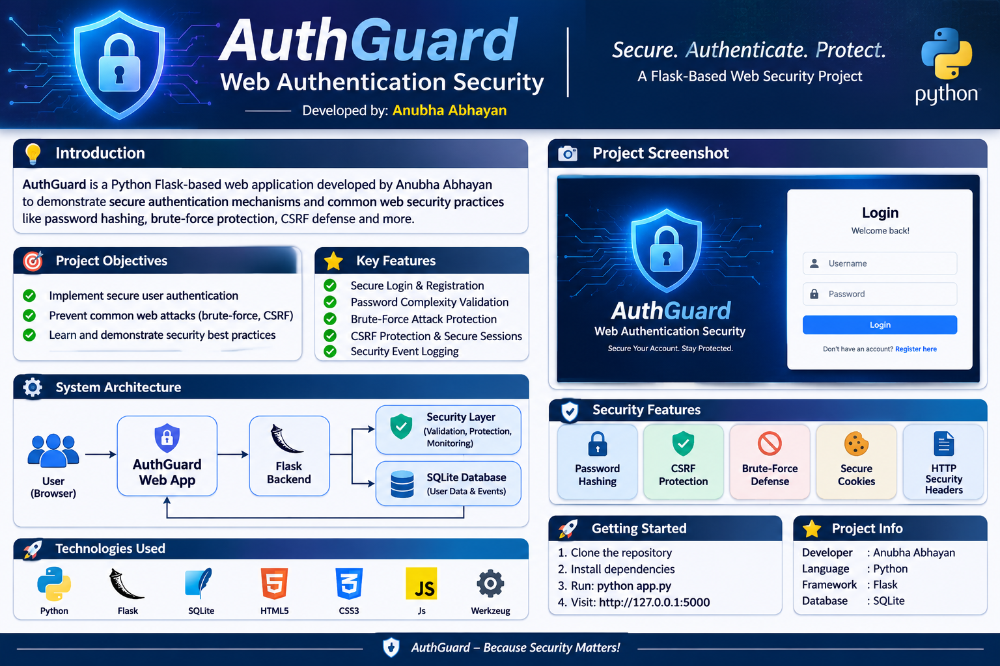
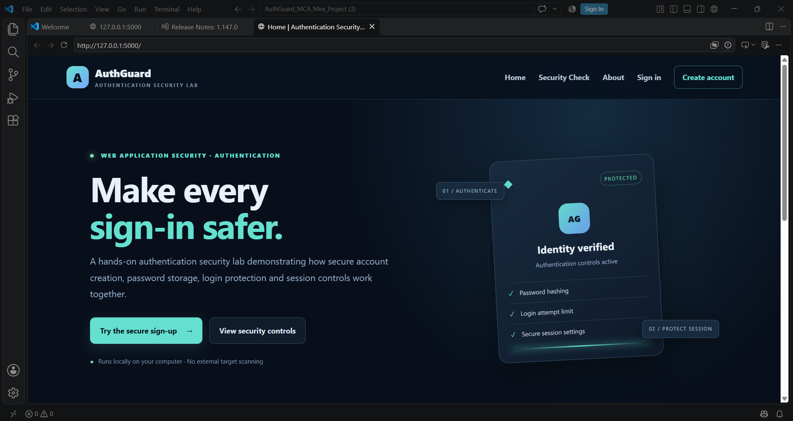

# 🛡️ AuthGuard – Web Authentication Security

### A Flask-Based Web Authentication and Security Project

**Developed By: ANUBHA ABHAYAN**

**Project Type:** MCA Mini Project  
**Subject:** INFORMATION SECURITY

---

## 1. Introduction

AuthGuard – Web Authentication Security is a Python Flask-based web application developed by **ANUBHA ABHAYAN** as a mini project for the subject **Information Security**.

In today's digital world, web applications handle sensitive user information and require strong security mechanisms to prevent unauthorized access and common cyber threats.

AuthGuard demonstrates how authentication-related risks can be reduced through password hashing, password complexity validation, brute-force attack protection, temporary account lockout, CSRF protection, secure session management, and HTTP security headers.

The project provides an interactive environment where users can register, log in, and explore security-related features.

It has been developed to gain practical knowledge of cybersecurity concepts and secure web application development.

## 2. Project Objectives

- Develop a secure web-based authentication system.
- Understand password hashing and verification.
- Implement password complexity validation.
- Demonstrate brute-force attack protection.
- Implement temporary account lockout.
- Understand CSRF protection.
- Improve session and cookie security.
- Configure HTTP security response headers.
- Maintain authentication and security event records.

## 3. Project Overview

AuthGuard provides an interactive web interface with authentication and security-related functionality.

### Main Features

- **User Registration:** Allows users to create accounts.
- **Secure Login:** Authenticates registered users.
- **Password Hashing:** Uses Werkzeug password hashing.
- **Password Validation:** Enforces password complexity requirements.
- **Brute-Force Protection:** Monitors unsuccessful login attempts.
- **Temporary Account Lockout:** Applies a two-minute lockout after five failed attempts.
- **CSRF Protection:** Validates CSRF tokens on POST forms.
- **Session Management:** Configures session cookie security settings.
- **Security Event Logging:** Stores authentication-related events.
- **HTTP Security Headers:** Demonstrates browser security response headers.
- **Security Console:** Provides access to account-related security information.

## 4. Technologies Used

| Technology | Purpose |
|---|---|
| Python | Backend programming |
| Flask | Web framework |
| SQLite | Database |
| HTML5 | Web page structure |
| CSS3 | Interface styling |
| JavaScript | Client-side functionality |
| Werkzeug | Password hashing |
| Jinja2 | Template rendering |
| Visual Studio Code | Development environment |

## 5. Project Architecture

AuthGuard follows a client-server architecture.

The user interacts with the web interface, while the Flask backend handles authentication requests and security operations. SQLite is used for storing application data and security events.

### System Architecture Diagram

The following diagram illustrates the major components and workflow of the AuthGuard application.



### Application Workflow

1. The user opens the AuthGuard web application.
2. The user registers or logs in.
3. The Flask backend processes the request.
4. Password verification and security checks are performed.
5. Login attempts are monitored.
6. Authenticated users can access the security console.
7. Security-related events are stored in the SQLite database.

## 6. Project Screenshots

### 6.1 Login Page

The following screenshot showcases the AuthGuard login interface, designed to provide a modern and user-friendly authentication experience.



## 7. Password Security

AuthGuard demonstrates password complexity validation and secure password storage.

The password policy requires:

- Minimum 10 characters.
- At least one uppercase letter.
- At least one lowercase letter.
- At least one number.
- At least one special character.

Passwords are stored using Werkzeug password hashing rather than being stored as plain text.

## 8. Brute-Force Attack Protection

Repeated unsuccessful login attempts can indicate a brute-force attack.

AuthGuard demonstrates a basic protection mechanism:

- Monitors failed login attempts.
- Applies a temporary account lockout after five failed attempts.
- Uses a two-minute lockout period for educational demonstration.

## 9. Database

The application uses SQLite for storing user information and security-related events.

The database supports the authentication and event logging functionality of the application.

## 10. Project Folder Structure

```text
AuthGuard-Web-Authentication-Security/
│
├── app.py
├── authguard.db
├── requirements.txt
├── README.md
├── authguard-ui-preview.png
├── authguard-project-overview.png
│
├── templates/
│
└── static/
    ├── style.css
    └── app.js
```

## 11. Installation and Execution

### Requirements

- Python 3.10 or newer
- Visual Studio Code (recommended)
- Web browser

### Step 1: Clone the Repository

```bash
git clone https://github.com/anubhaabhayan/AuthGuard-Web-Authentication-Security.git
```

### Step 2: Open the Project Folder

```bash
cd AuthGuard-Web-Authentication-Security
```

### Step 3: Create a Virtual Environment

```bash
py -m venv venv
```

### Step 4: Activate the Environment

```bash
venv\Scripts\activate
```

### Step 5: Install Dependencies

```bash
pip install -r requirements.txt
```

### Step 6: Run the Application

```bash
python app.py
```

### Step 7: Open in Browser

```text
http://127.0.0.1:5000
```

The application will be accessible locally.

## 12. Project Demonstration

The following steps can be used to demonstrate the project:

1. Open the AuthGuard home page.
2. Navigate to the registration page.
3. Create a demonstration account.
4. Show password complexity validation.
5. Log in using the registered credentials.
6. Access the security console.
7. Demonstrate failed login attempts and temporary lockout.
8. Show recorded security events.
9. Open the Security Check section.
10. Explain the configured HTTP security headers.

## 13. Learning Outcomes

This project demonstrates practical concepts related to:

- Web application authentication.
- Password hashing and verification.
- Brute-force attack prevention.
- CSRF protection.
- Secure session management.
- HTTP security headers.
- SQLite database integration.
- Secure web application development.

## 14. Limitations

- Designed primarily for educational and local demonstration.
- Not intended as a complete enterprise authentication platform.
- Uses a short account lockout period for classroom demonstration.
- Does not perform external website vulnerability scanning.
- The Flask development server is not intended for production deployment.

## 15. Future Enhancements

- Multi-Factor Authentication (MFA).
- Email verification.
- Password reset functionality.
- CAPTCHA integration.
- Advanced rate limiting.
- Role-Based Access Control.
- Enhanced security monitoring.
- Production deployment.

## 16. Project Information

| Field | Details |
|---|---|
| Project Name | AuthGuard – Web Authentication Security |
| Developed By | ANUBHA ABHAYAN |
| Course | Master of Computer Applications (MCA) |
| Project Type | Mini Project |
| Subject | Information Security |
| Domain | Cybersecurity |
| Programming Language | Python |
| Framework | Flask |
| Database | SQLite |
| Frontend | HTML, CSS, JavaScript |

## 17. GitHub Repository

**Repository Link:**

https://github.com/anubhaabhayan/AuthGuard-Web-Authentication-Security

## 18. Disclaimer

This project has been developed for educational and demonstration purposes as part of the Information Security subject.

It should not be considered a fully production-ready authentication platform. Use demonstration credentials only. Before public deployment, configure a strong secret key, HTTPS, secure cookie settings, a production-ready server, and conduct an appropriate security review.

---

**Developed By: ANUBHA ABHAYAN**

**MCA Mini Project | INFORMATION SECURITY**

*AuthGuard – Because Security Matters!*
